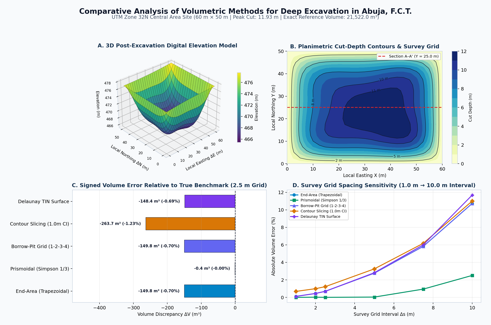

# Comparative Analysis of Volumetric Methods for Deep Excavation in Abuja, F.C.T.

[](#automated-mathematical-verification)
[](#repository-structure)
[](matlab/abuja_excavation_volumetrics.m)
[](index.html)

**Author:** Shekwomagode Aaron Tonya Solomon  
**Background:** B.Tech. in Surveying and Geoinformatics — *Federal University of Technology, Minna*  

---

## Overview

Accurate earthwork volume estimation is critical in commercial deep basement excavations across **Abuja, F.C.T.**, where over- or under-estimating cut volumes directly translates into thousands of dollars in excavation, haulage, and contract billing discrepancies.

This project benchmarks **five classical Geomatics & Civil Surveying volumetric formulations** in both **Python** and **MATLAB** against an exact continuous 2D Gauss–Kronrod analytical quadrature benchmark across a **60 m × 50 m deep excavation pit** in **Central Area, Abuja (`UTM Zone 32N: 332,400 m E, 1,001,800 m N`)**, paired with an **interactive browser-based 3D Digital Elevation Model (DEM) & Cross-Section Slicer (`index.html`)**.



---

## Methods Benchmarked

| # | Surveying Method | Mathematical Formulation | Truncation Order |
| :- | :--- | :--- | :--- |
| **1** | **Average End-Area (Trapezoidal)** | $V = \sum_{j} \frac{\Delta y}{2}(A_j + A_{j+1})$ | $\mathcal{O}(\Delta s^2)$ |
| **2** | **Prismoidal (Composite Simpson's $1/3$)** | $V = \frac{\Delta y}{3}\left(A_0 + 4\sum_{\text{odd}} A_j + 2\sum_{\text{even}} A_j + A_M\right)$ | $\mathcal{O}(\Delta s^4)$ |
| **3** | **Spot-Height Borrow-Pit Grid (`1-2-3-4`)** | $V = \frac{\Delta x \Delta y}{4}\left(\sum h_1 + 2\sum h_2 + 3\sum h_3 + 4\sum h_4\right)$ | $\mathcal{O}(\Delta s^2)$ |
| **4** | **Horizontal Contour Slicing** | $V = \sum_k \frac{\Delta z}{3}\left(A_k + A_{k+1} + \sqrt{A_k A_{k+1}}\right)$ | $\mathcal{O}(\Delta z^2)$ |
| **5** | **Delaunay TIN Surface** | $V = \sum_{\triangle} \text{Area}_{2\text{D}}(\triangle)\cdot \frac{d_A + d_B + d_C}{3}$ | $\mathcal{O}(\Delta s^2)$ |

---

## Key Quantitative Findings (`2.5 m × 2.5 m` RTK-GNSS Survey Grid — 525 Stations)

Exact 2D Gauss–Kronrod Reference Cut Volume: **`21,521.96 m³`** *(at `$8.50/m³` excavation & haulage rate and `1.22×` soil swell factor)*:

| Volumetric Method | Bank Volume (`m³`) | Bulked Volume (`m³`) | Signed Error (`m³`) | Relative Error | Haulage Cost Discrepancy (`$ USD`) |
| :--- | ---: | ---: | ---: | ---: | ---: |
| **Prismoidal (Simpson 1/3)** | **21,521.53** | **26,256.27** | **-0.44** | **-0.0020%** | **-$3.70** |
| **Delaunay TIN Surface** | 21,373.58 | 26,075.77 | -148.38 | -0.6894% | -$1,261.25 |
| **End-Area (Trapezoidal)** | 21,372.18 | 26,074.06 | -149.79 | -0.6960% | -$1,273.18 |
| **Borrow-Pit Grid (1-2-3-4)** | 21,372.18 | 26,074.06 | -149.79 | -0.6960% | -$1,273.18 |
| **Contour Slicing (1.0m CI)** | 21,258.30 | 25,935.13 | -263.66 | -1.2251% | -$2,241.14 |

### Engineering Takeaways
1. **Superior Curvature Capture (`Prismoidal / Simpson 1/3`):** Reduces volume error from **`-149.8 m³` (`-$1,273`)** down to **`-0.44 m³` (`-0.002%`)** on curved battered slopes, retaining `< 0.05%` error even when field survey station spacing doubles from `2.5 m` to `5.0 m` (**75% fewer field shots needed**).
2. **Exact Equivalence on Structured Grids:** Demonstrates numerically that **Average End-Area** and **Spot-Height `1-2-3-4` Borrow-Pit Grid** yield identical volumes (`21,372.18 m³`) on uniform rectangular survey matrices because both represent bilinear tensor-product trapezoidal quadrature.
3. **Contour Interval Truncation:** Horizontal contour planimetry (`1.0 m` interval) exhibits the largest discrepancy (`-1.23%`) due to vertical slice discretization near the undulating basement floor.

---

## Repository Structure

```text
abuja-excavation-volumetrics/
├── index.html                        # Zero-dependency interactive 3D DEM & cross-section web app
├── run_analysis.py                   # Full Python benchmark + 4-panel figure generator
├── src/
│   ├── dataset_generator.py          # Synthetic UTM Zone 32N survey generator & 2D quadrature ground truth
│   └── volumetric_methods.py         # All 5 Geomatics volumetric algorithms + Prismoidal Correction
├── matlab/
│   └── abuja_excavation_volumetrics.m # Companion MATLAB script mirroring all 5 methods
├── tests/
│   └── test_volumetrics.py           # Pytest suite verifying exact Surveying theorems
├── data/
│   └── abuja_deep_excavation_survey.csv
└── outputs/
    ├── method_comparison_summary.csv
    ├── grid_convergence_summary.csv
    └── volumetric_benchmark_dashboard.png
```

---

## Quick Start

```bash
pip install -r requirements.txt
pytest -v
python run_analysis.py
```

To explore the interactive 3D Digital Elevation Model in any browser (or deploy directly via **GitHub Pages**), open **`index.html`**.
